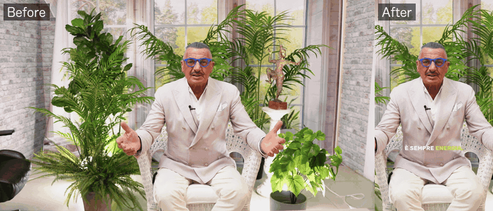
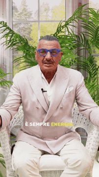
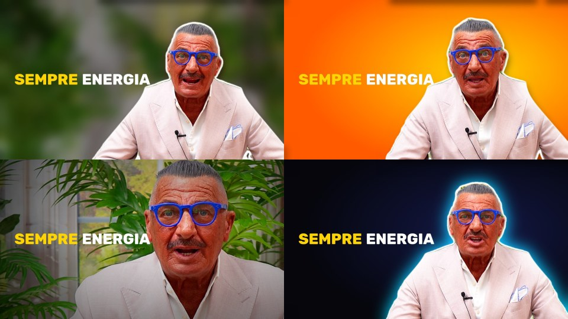

# Shorts Studio

**Turn long horizontal videos into finished vertical shorts — on your own computer, no subscription, no upload.**

Face-following reframe, automatic jump cuts, word-by-word captions, cinematic audio, face restoration, skin-tone fix, social camera moves and click-worthy thumbnails, in one desktop app. The same engine also ships as **free scripts for DaVinci Resolve** (they work on the free version).

<!-- Demo media: see docs/media/README.md to (re)generate these from your own footage -->
<p align="center">
  
  
  
</p>

## Why

Tools like OpusClip, Submagic or CapCut Pro do this in the cloud for $15–30 a month. Shorts Studio runs **locally** (your footage never leaves your machine), works **offline** after the first model download, and processes a whole folder in **batch**.

## Features

| | |
|---|---|
| **Smart reframe** | Follows the main face shot by shot (no jitter between two people), or cuts to *whoever is talking*. Pick the person to follow from thumbnails; drag the crop to correct any moment by hand. Split screen for two-person podcasts. 9:16, 4:5, 1:1 and 16:9 from one analysis. |
| **Auto edit** | Removes pauses, breaths, filler words (*uhm, ehm*) and repeated takes. A "best moments" finder proposes 30–60 s clips from a long video. |
| **Captions** | Whisper transcription (runs locally), TikTok-style word-by-word highlight, built-in subtitle editor with find & replace, English translation or bilingual captions. |
| **Look & feel** | Punch-in on phrases, handheld drift, crash zooms, whip/zoom/glitch transitions; colour looks and auto white balance; stabilisation; skin-tone normalisation (fixes "lobster red" camera skin); beauty (smoothing, blemishes, wrinkles). |
| **Faces** | AI face restoration (GFPGAN, GPEN, CodeFormer) for soft or compressed footage. |
| **Audio** | One-click cinematic dialogue chain (denoise, de-ess, de-reverb, EQ, −14 LUFS), background music ducked under the voice. Hear the treated audio live in the preview, with A/B. |
| **Publishing** | Hook title for the first seconds, logo watermark, closing call to action, cover image, YouTube/Shorts thumbnails (subject cut-out, outline, big text), title/description/hashtags drafted from the transcript. |
| **Workflow** | Live preview with timeline, safe-zone overlay for TikTok/Reels/Shorts, undo/redo, projects with autosave, presets, disk cache, hardware encoding (VideoToolbox), light proxies for heavy 4K/HEVC camera files. |

The app's interface is currently in **Italian** (English UI is planned — contributions welcome).

## Quick start

### Shorts Studio (macOS; Linux works, Windows untested)

Requires Python 3.9+ and ffmpeg (bundled automatically via `imageio-ffmpeg`).

```bash
git clone https://github.com/canardu1/shorts-studio.git
cd shorts-studio
pip install -e ".[app]"
face-reframe-app
```

On macOS you can also double-click `Shorts Studio.command`: the first run creates its own environment and installs everything. To build a standalone `.app`: `packaging/build_mac.sh`.

Typical flow: add videos → **Analizza volti** (analyse faces) → tune on the live preview → **Crea short**.
The full option guide is in [docs/shorts-studio.md](docs/shorts-studio.md).

### DaVinci Resolve scripts

```bash
python install.py --deps
```

Then restart Resolve and use **Workspace › Scripts**: Face Reframe, Cut Pauses, Cut Fillers, Cut Breaths, Cut Retakes, Auto Subtitles, Punch In, Cinematic Audio, Normalize Audio/Color, Enhance, Duck Music, Sync Audio, Auto Markers, Split At Cuts and a one-dialog Shorts Pipeline. Details: [docs/resolve-tools.md](docs/resolve-tools.md).

### Command line

```bash
face-reframe interview.mp4 -o short.mp4 --subject speaker
python -m face_reframe.cut in.mp4 -o out.mp4
python -m face_reframe.cinematic in.mp4 -o out.mp4
```

## Performance

Measured on an Apple M1, 1080p source:

| Step | Time |
|---|---|
| Face restoration GPEN-256 / GFPGAN / CodeFormer | 0.15 / 2.1 / 5 s per face per frame |
| Beauty, skin fix, looks, camera moves | a few ms per frame |
| Thumbnails (4 variants) | ~1.5 s |
| Encoding (VideoToolbox vs x264 medium) | ~2× faster |

A "PC lento" preset keeps everything usable on older machines.

## Models

Small ONNX models run on the CPU through OpenCV / onnxruntime. Some ship with the repo, the others download on first use into `~/Library/Application Support/ShortsStudio/models` (macOS) or the platform equivalent. Licences are listed in [THIRD_PARTY_NOTICES.md](THIRD_PARTY_NOTICES.md) — note that **CodeFormer and GPEN are for non-commercial use only**.

## Development

```bash
pip install -e ".[app]" pytest scikit-image
QT_QPA_PLATFORM=offscreen python -m pytest
```

The Resolve/Fusion logic is tested against a fake Resolve API; the app has offscreen GUI tests. See [CONTRIBUTING.md](CONTRIBUTING.md).

## Support the project

If Shorts Studio saves you time, you can [sponsor its development](https://github.com/sponsors/canardu1) — or just star the repo and share a short you made with it.

## License

[GPL-3.0](LICENSE) © 2026 Carlo Anardu. Third-party components keep their own licences, see [THIRD_PARTY_NOTICES.md](THIRD_PARTY_NOTICES.md).
