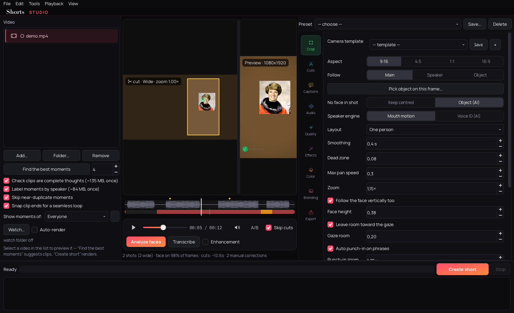
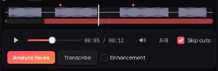
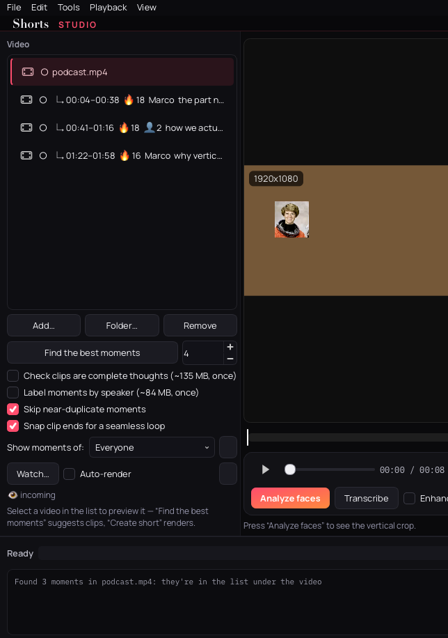
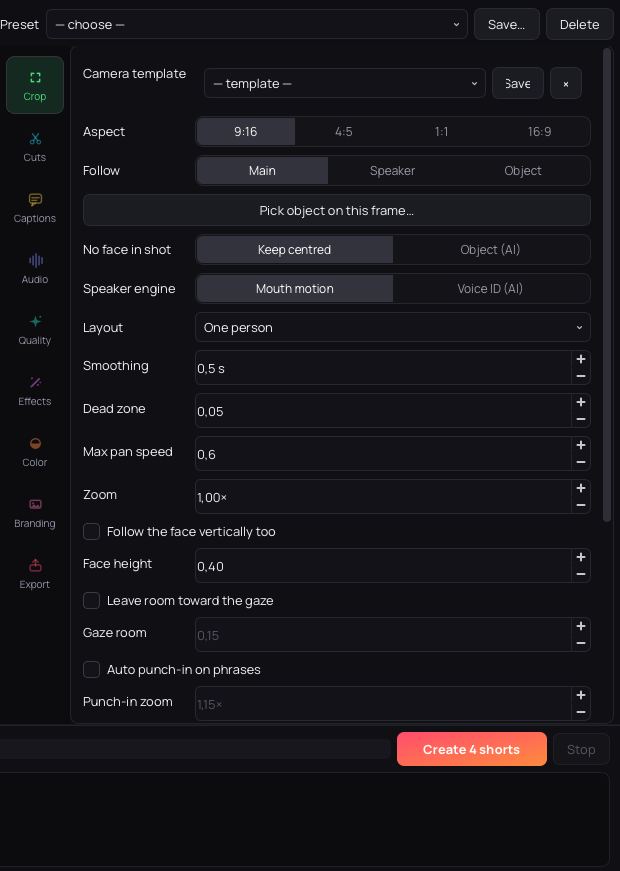

<div align="center">

# 🎬 Shorts Studio

**Turn long horizontal videos into finished vertical shorts —<br>on your own computer. No subscription, no upload, no cloud.**

[](LICENSE)
[](pyproject.toml)
[](#download--install--2-minutes-no-terminal)
[](#models)



</div>

<br>

Face-following reframe, automatic jump cuts, word-by-word captions, cinematic audio, face restoration, camera moves and click-worthy thumbnails — one dark, quiet desktop app. **A free, open-source alternative to OpusClip, Submagic and CapCut Pro** that turns podcasts, interviews, streams and long recordings into ready-to-post TikTok, Instagram Reels and YouTube Shorts clips. The same engine also ships as **free scripts for DaVinci Resolve** (works on the free version too).

## See it in action

<p align="center">
  
  
</p>
<p align="center">
  
  
</p>

<p align="center"><sub>
Automatic 16:9 → 9:16 reframe · word-by-word captions + punch-in · manual timeline cuts · auto thumbnails<br>
<i>Demo clips generated from your own footage — see <a href="docs/media/README.md">docs/media</a></i>
</sub></p>

## New in 0.8.0 — hands-off

- **Watch folder** — drop a video into a watched folder and it's queued automatically; tick **Auto-render** and it renders with your current settings, hands-off
- **Smarter best moments** — speaker-labelled clips (👤, rename to *Marco* with the ✎ and it sticks in the project), semantic **near-duplicate skipping**, **seamless-loop** end snapping, and **chapters export** for YouTube/CSV
- **CLI v2** — `face_reframe render` runs the whole pipeline headless: presets, templates, `--moments N`, any option via `--set`
- **CoreML on Apple Silicon** — vision models run up to ~2.6× faster (CPU fallback always available, `SHORTS_CPU_ONLY=1` to force)
- **Template system everywhere** — 14 content presets × 4 camera styles × 6 voice chains × 7 colour grades × 8 caption styles × 5 platform exports, plus your own ★ templates
- **In-app update check**, undo on *Remove*, mono timecode font, spectrum settings rail

<p align="center">
  
  
</p>
<p align="center"><sub>Speaker-labelled, deduped, loop-snapped moments · spectrum rail + per-tab templates</sub></p>

## A free, offline alternative to OpusClip & CapCut

Tools like OpusClip, Submagic or CapCut Pro do this in the cloud for **$15–30 a month**. Shorts Studio runs **locally** — your footage never leaves the machine, it works **offline** after the first model download, and it processes a whole folder in **batch** while you do something else.

| | **Shorts Studio** | OpusClip · Submagic · CapCut Pro |
|---|---|---|
| **Price** | Free · GPL-3.0 | $15–30/month subscription |
| **Processing** | 100% local — works offline | Upload to their cloud |
| **Privacy** | Footage never leaves your disk | Your videos on their servers |
| **Batch** | Whole folder, unattended | Mostly per-video |
| **Fine editing** | Manual timeline cuts + automatic | Mostly automatic only |
| **Runs on** | Your Mac/PC, no account | Browser, account required |
| **DaVinci Resolve** | Free companion scripts | — |

The honest trade-off: cloud tools offer web editors, team features and zero install. Shorts Studio is for creators who'd rather keep the footage — and the money — on their own machine.

## Download & install — 2 minutes, no terminal

**Mac with an Apple chip (M1, M2, M3, M4 — any Mac from late 2020 on):**

1. **[⬇ Download the app](https://github.com/canardu1/shorts-studio/releases/latest/download/ShortsStudio-macOS-arm64.zip)**
2. Double-click the downloaded file to unzip it
3. Drag **Shorts Studio** into your **Applications** folder
4. First launch only: **right-click the app → Open**, then **Open** again — macOS warns once because the app isn't signed with an Apple certificate, then it runs normally

No installer, no account, no admin password. Each AI feature downloads its model **once** on first use (a few MB) — after that, everything works fully offline.

**Your first short in 3 steps:** drop a video onto the list → **Analyze faces** → **Create short**. Everything else is optional tuning on the live preview.

*Older Intel Mac, Linux, or prefer the terminal? → [advanced install](#advanced-install)*

## Features

<table>
<tr>
<td width="50%" valign="top">

### 🎯 Reframe
- **Face-following 16:9 → 9:16** crop with smooth "camera operator" motion and a hard jump at every cut
- **Shot detection** — wide shots get an automatic punch-in so the speaker fills the frame
- **Who to follow:** main person, per-shot lock, or **whoever is talking** (mouth heuristic or neural **ECAPA voice ID**)
- **Follow object** — the crop chases the salient thing in faceless shots (products, pets, B-roll)
- **Pick an object** — draw a box, NanoTrack follows it in both directions
- **Person picker** — face-recognised thumbnails of everyone, pick who matters
- **Hand corrections** — drag the crop on any frame; "auto from here" hands control back
- **Look room, split screen** for two-person podcasts, **multi-format** 9:16/4:5/1:1/16:9

### ✂️ Editing
- **Cut pauses** (Silero VAD or level/dB), **cut breaths**, **cut fillers**, **cut retakes** — last take wins
- **Best moments finder** — strongest 30–60 s clips, boosted by **YAMNet** laughter/applause/music detection; tick *"Check clips are complete thoughts"* and optional **MiniLM** sentence embeddings (multilingual, ~135 MB once) penalise clips that start mid-discussion or switch topic halfway
- **Speaker-labelled moments** — **ECAPA voice ID** tags each suggested clip with who's talking; filter to one voice, rename speakers (persists in the project)
- **Near-duplicate skipping** — the same story told twice keeps only the stronger take (MiniLM semantic match, or word overlap without it)
- **Seamless-loop ends** — each clip's end snaps to the frame that best matches its opening, so the short replays invisibly
- **Chapters export** — the moments become YouTube description chapters or CSV markers on the *source* timeline
- **Manual timeline editing** — drag a range, **X** to cut (amber, on top of the automatic cuts), right-click to restore; **B** marks a blade point, second **B** cuts between marks; selection **snaps** to shot cuts, markers and events; trim clip edges or cut to end from the same menu; everything undoable
- **Audio waveform lane** — the timeline shows a peak envelope above the cut bar, so dead air reads as flat stretches you can spot and cut at a glance
- **Clip ranges** + **batch** a whole folder

### 💬 Captions
- Local **Whisper transcription**, cached per file
- **TikTok-style word-by-word** captions or classic lines — colour, position, uppercase
- **Full styling** — any installed font, size, text/highlight colours, optional pill box, motion (fade, slide-up, pop-on-word)
- **Style templates** — 8 one-click caption looks (Default, Hormozi, Karaoke neon, Podcast bold, Emoji burst, Broadcast…) plus your own saved styles
- **Auto-emoji** on keywords 🔥💰🤫 and **karaoke sweep** highlight — the OpusClip caption look, fully local
- **Virality score** — every suggested clip gets a 🔥 score (hook, speech density, laughter, clean ending)
- **Subtitle editor** — fix words, find & replace, timings re-spread automatically
- **English translation** or **bilingual** captions

</td>
<td width="50%" valign="top">

### 🎥 Moves & image
- **Punch-in** on every phrase · handheld drift · slow push-in · crash zoom · impact shake — **beat-synced** to your music track
- **Transitions:** whip pan, zoom, glitch — **stabilisation** per shot
- **Slow motion ×2/×4** — **RIFE** invents real in-between frames, or instant FFmpeg blend
- **Face restoration:** GPEN-256/512, GFPGAN, CodeFormer — only on faces worth restoring (size + frontality gates), faded in over a few frames, source tones preserved
- **Skin-tone fix** (exportable `.cube` LUT) · **Beauty** with neural face-parsing mask
- **Colour:** 6 looks + **your own .cube LUTs** + auto WB + full manual **grade** (temp, tint, EV, contrast, sat, shadows, highlights, vignette)
- **Lift dark shots** — SG-LLIE or URetinex neural low-light
- **Blur background** — RVM fast or **MODNet** quality matting, guided-filter edges
- **Enhance** — fast sharpen or Real-ESRGAN upscaling, **colour-locked** to the source so the palette can't drift or flicker

### 🎚️ Audio
- **Cinematic dialogue** in one click: denoise (**RNNoise** / **DeepFilterNet** / FFT), de-ess, de-reverb, rumble cut, compression, −14 LUFS
- **Mains hum removal** — detects the real buzz frequency (50/60 Hz ± drift) and notches it + harmonics
- **Music ducked** under the voice with a sidechain compressor
- **Live A/B preview** of the treated audio while you tune

### 🚀 Publishing
- **Hook title** on screen for the first seconds
- **Logo/watermark** + closing **CTA** card
- **Progress bar** along the edge — the "watch to the end" cue
- **Intro/outro cards** — full-frame brand images at the start and end
- **Before/after video** — one click exports a side-by-side comparison clip, ready to post

### 🎬 Virtual studio
- **Digital green screen** — cut the person out with the neural matte and drop them over a **solid colour**, an **image** or a **looping video**
- Guided-filter matte refinement keeps hair and edges believable (RVM for speed, MODNet for quality)
- **Thumbnails** that look like a creator made them — best expressive frame, cut-out subject, 4 styles, highlighted word
- **Title, description and hashtags** drafted from the transcript

### 🧰 Workflow
- **Watch folder** — new videos in a chosen folder queue themselves; **Auto-render** makes it fully hands-off
- Live side-by-side preview · safe-zone overlay for TikTok/Reels/Shorts
- **Undo/redo** — timeline edits, hook text and queue removals all undoable · **projects** with autosave
- **Presets & templates** — content-type recipes (Interview, Gaming, ASMR, Archive restore…) plus saveable templates for camera styles, voice chains, colour grades, caption styles and per-platform export
- **In-app update check** against GitHub releases (opt-out, silent when offline)
- Native **macOS menu bar** (File/Edit/Tools/Playback/View) with standard ⌘ shortcuts
- Disk cache, proxies for 4K HEVC, VideoToolbox encoding, **CoreML acceleration** on Apple Silicon (`SHORTS_CPU_ONLY=1` to force CPU)
- **Interlaced & VFR sources** — old TV/DV clips and wonky phone captures are normalised once on ingest (bwdif deinterlace + CFR), so the reframe never combs and audio never drifts
- Long renders keep the Mac awake until done

</td>
</tr>
</table>

## How it works

Every step runs on your machine — no API calls, no upload:

1. **Listen** — faster-whisper transcribes the audio once (cached on disk); Silero VAD or level thresholds mark pauses, breaths, filler words and retakes.
2. **Look** — YuNet face detection + FaceMesh landmarks track every face per shot; optional ECAPA voice embeddings match *who is talking* to the right face.
3. **Plan** — a virtual camera operator decides the crop: smoothing, dead zone, pan-speed limits, punch-ins on phrases, hard jump on cuts. Manual corrections, saliency following and picked-object tracking feed into the same plan.
4. **Render** — FFmpeg + OpenCV compose the vertical frame: reframe, optional RVM/MODNet matting, neural enhancement, styled captions, LUT-baked colour grade, retimed audio.
5. **Publish** — thumbnails, cover image, title/description/hashtags drafted from the transcript.

### 🧩 DaVinci Resolve scripts (free version included)

Face Reframe (non-destructive Fusion keyframes or render), Cut Pauses/Fillers/Breaths/Retakes, Auto Subtitles, Punch In, Cinematic Audio, Normalize Audio/Color, Enhance, Duck Music, Sync Audio, Auto Markers, Split At Cuts and a one-dialog **Shorts Pipeline**.

<sub>The app's interface is in **English** by default; Italian is available from the Export tab (**UI language**, applies on restart).</sub>

## Advanced install

### macOS — one command (also for Intel Macs)

```bash
curl -fsSL https://raw.githubusercontent.com/canardu1/shorts-studio/main/install.sh | bash
```

Installs everything in `~/.shorts-studio` (private Python, no admin) and creates **Shorts Studio** in your Applications folder. Re-run to update; uninstall with `rm -rf ~/.shorts-studio ~/Applications/"Shorts Studio.app"`. [install.sh](install.sh) is short — read it first if you like.

### From source (macOS, Linux; Windows untested)

```bash
git clone https://github.com/canardu1/shorts-studio.git
cd shorts-studio
pip install -e ".[app]"
face-reframe-app
```

Standalone `.app` bundle: `packaging/build_mac.sh`.
Full option guide: [docs/shorts-studio.md](docs/shorts-studio.md).

### DaVinci Resolve scripts

```bash
python install.py --deps
```

Restart Resolve → **Workspace › Scripts**. Details: [docs/resolve-tools.md](docs/resolve-tools.md).

### Command line

```bash
# full pipeline, headless — same presets/templates/moments as the app
face_reframe render podcast.mp4 --preset "2-person podcast" \
    --style "camera:Tight podcast" --style "voice:Podcast voice" \
    --set subtitles=burn --moments 5 -o shorts/
face_reframe render --list            # every preset and template name

# classic reframe-only tools
face-reframe interview.mp4 -o short.mp4 --subject speaker
python -m face_reframe.cut in.mp4 -o out.mp4
python -m face_reframe.cinematic in.mp4 -o out.mp4
```

## Performance

Measured on an Apple M1, 1080p source:

| Step | Time |
|---|---|
| Face restoration GPEN-256 / GFPGAN / CodeFormer | 0.15 / 2.1 / 5 s per face per frame |
| Beauty, skin fix, looks, camera moves | a few ms per frame |
| Thumbnails (4 variants) | ~1.5 s |
| Encoding (VideoToolbox vs x264 medium) | ~2× faster |
| Matting via **CoreML EP** (M-series) vs CPU | ~2.6× faster |

A "PC lento" preset keeps everything usable on older machines.

## Models

Small ONNX models on CPU (OpenCV / onnxruntime). Some ship with the repo, the rest download **once** on first use into `~/Library/Application Support/ShortsStudio/models` — then everything works offline.

| Family | Models | Size |
|---|---|---|
| Face restore | GPEN-256/512, GFPGAN, CodeFormer | 24–370 MB |
| Matting | RVM, MODNet | 14–24 MB |
| Saliency / tracking | U²-Net-p, NanoTrack | 5 + 1.7 MB |
| Audio | YAMNet events, ECAPA voice ID, DeepFilterNet | 16–84 MB |
| Video | RIFE interpolation, Real-ESRGAN, BiSeNet beauty | 0.06–89 MB |
| Speech | Silero VAD, faster-whisper | bundled |
| Text | MiniLM sentence embeddings (highlights) | 135 MB |

Licences: [THIRD_PARTY_NOTICES.md](THIRD_PARTY_NOTICES.md) — note that **CodeFormer and GPEN are for non-commercial use only**.

## FAQ

**Is my footage uploaded anywhere?**
Never. Everything runs on your machine. Neural models download once on first use — after that the app works fully offline.

**Does it add a watermark?**
No. The only watermark is the one *you* optionally add (logo / CTA card).

**Does it work on Windows or Linux?**
macOS and Linux are supported; Windows is untested. The one-line installer targets macOS — from source it runs anywhere Python + FFmpeg run.

**How long does an export take?**
Roughly real-time to ~3× on an Apple M1 without face restoration. Neural options (face restore, MODNet matte, RIFE slow-mo) cost per frame — the "PC lento" preset keeps older machines usable.

**Can I fix the automatic edit by hand?**
Yes — drag on the timeline to select a range, cut or restore it (amber ranges sit on top of the automatic red cuts), trim the clip edges from the right-click menu. Every step is undoable and saved inside the project file.

**Does it work on videos without faces, or already-vertical ones?**
Yes. Faceless shots follow the most salient region (U²-Net-p) or an object you pick with a box; vertical sources can skip the reframe and still use the whole editing/captions pipeline.

**What happens if a neural model is missing?**
The app logs it and falls back to the classic method — exports never fail because of an optional model.

## Development

```bash
pip install -e ".[app]" pytest scikit-image
QT_QPA_PLATFORM=offscreen python -m pytest
```

Resolve/Fusion logic is tested against a fake Resolve API; the app has offscreen GUI tests.
UI screenshots/GIFs regenerate with `python scripts/shoot_ui.py`; footage demos with `scripts/make_demo.py`.
See [CONTRIBUTING.md](CONTRIBUTING.md).

## Support the project

If Shorts Studio saves you time, you can [sponsor its development](https://github.com/sponsors/canardu1) — or just star the repo and share a short you made with it.

## License

[GPL-3.0](LICENSE) © 2026 Carlo Anardu. Third-party components keep their own licences — see [THIRD_PARTY_NOTICES.md](THIRD_PARTY_NOTICES.md).
